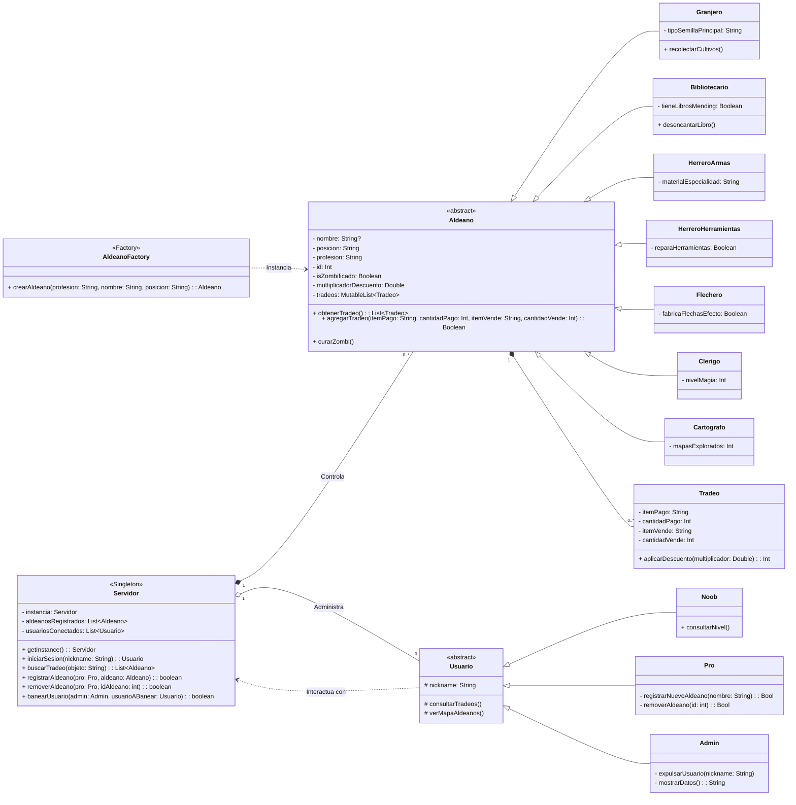

# Minecraft Villager Management

## Descripción del problema

En los mundos multijugador técnicos o de supervivencia a largo plazo en Minecraft, es común agrupar
decenas de aldeanos en zonas conocidas como "Trading Halls" (salas de comercio).
Sin embargo, a medida que la zona crece, la cantidad de aldeanos se vuelve inmanejable.

Hoy en día, los jugadores intentan organizar esta zona usando carteles de madera o
simplemente confiando en su memoria. Esto genera varios problemas:

1. Pérdida de tiempo: Los jugadores olvidan qué aldeano vende qué objeto exacto y pasan
    minutos buscando sin rumbo.
2. Posición: No hay registro claro de en qué coordenadas exactas se
    encuentra el aldeano que vende un encantamiento crucial (como Mending/Reparación).
3. Falta de administración: Cualquier jugador nuevo puede entrar, alterar los intercambios
    o perder aldeanos sin que haya un registro de quién hizo qué.

**Minecraft Villager Management** reemplaza los carteles y la memoria por un sistema de
registro estructurado. El sistema permite buscar rápidamente qué aldeano vende el objeto
deseado, conocer sus coordenadas exactas y restringir quién puede añadir o eliminar aldeanos
de la base de datos.

Alcance de esta versión:

- Sistema interactivo por consola.
- Datos almacenados temporalmente en memoria durante la ejecución.
- Fuera de alcance: Modificaciones directas dentro del juego (no es un mod, es una
  herrramienta externa de gestión).

## Usuarios del sistema

El sistema divide a los jugadores en tres categorias según su nivel de confianza y experiencia en
el servidor:

| Usuario | Tarea desempeñada en el sistema |
| :---: | :---: |
| Noob | Tiene permisos de solo lectura. Su vista es superficial: busca objetos a la venta y consulta las coordenadas para saber a dónde ir.|
| Pro | Tiene permisos de escritura. Además de consultar, es el encargado de registrar nuevos aldeanos en el sistema y eliminarlos si mueren o son movidos. |
| Admin | Tiene el control total. Se encarga de mantener el orden, con la capacidad exclusiva de expulsar (banear) a usuarios problemáticos del sistema. |

## Diagrama UML (Avance)

A continuación, se detalla la estructura lógica del sistema:

